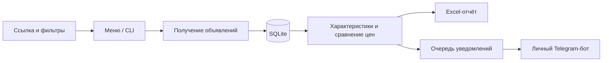

<p align="center">
  
</p>

<p align="center">
  <a href="https://github.com/dragonkhan1012/avito-market-monitor/actions/workflows/tests.yml"></a>
  
  
  
  
</p>

# Avito Market Monitor

**Личный мониторинг объявлений: от сохранённого поиска до истории цен и понятного отчёта.**

Приложение собирает доступные объявления по ссылке поиска Avito, сохраняет их в SQLite, отслеживает изменения цены и сравнивает сопоставимые товары. Результаты доступны в Excel, а подходящие предложения можно получать в своём Telegram-боте.

Основной интерфейс — меню в терминале и команды Python. На macOS предусмотрен запуск двойным щелчком через `.command`.

**[Быстрый старт](#быстрый-старт)** · **[Возможности](#возможности)** · **[Команды](#команды)** · **[Как считается выгода](#как-считается-выгода)** · **[Документация](#документация)**

## Возможности

| Задача | Что делает приложение |
| --- | --- |
| Сохранить поиск | Принимает ссылку Avito с городом, категорией и фильтрами |
| Следить за объявлениями | Разовый обход или повторяющийся мониторинг нескольких поисков |
| Продолжить после остановки | Сохраняет прогресс страниц, объявления и очередь обработки в SQLite |
| Отследить цену | Ведёт историю наблюдений и изменений цены |
| Сравнить комплектации | Различает модели и конфигурации MacBook и iPhone; неизвестные данные отмечает для проверки |
| Найти интересные предложения | Сравнивает цену с другими похожими объявлениями в том же городе |
| Получить отчёт | Создаёт Excel с предложениями, рынком, объявлениями, историей цен и состоянием сбора |
| Подключить Telegram | Отправляет уведомления и показывает предложения через команды бота |
| Работать с недвижимостью | Отдельный профиль `realty-owner` с признаками собственника и агентства |

## Быстрый старт

Понадобится Python **3.11+**. Для установки зависимостей рекомендуется [uv](https://docs.astral.sh/uv/getting-started/installation/).

Скачайте проект через **Code → Download ZIP** или клонируйте:

```bash
git clone https://github.com/dragonkhan1012/avito-market-monitor.git
cd avito-market-monitor
uv sync --locked
uv run python avito.py
```

Выберите добавление поиска в меню и вставьте ссылку Avito с нужными фильтрами. У каждого поиска будет своё имя, база и отчёт.

### Запуск на macOS

После установки окружения откройте один из файлов двойным щелчком:

- **`Avito Parser.command`** — меню и выбор действия.
- **`Мониторинг рынка.command`** — запуск всех сохранённых поисков товаров.

Остановка — **Ctrl+C** в терминале. Закрытие окна и сон компьютера приостанавливают работу; следующий запуск использует сохранённый прогресс.

### Windows и Linux

Откройте терминал в папке проекта и выполните `uv run python avito.py`. Запуск без `uv` и подготовка окружения описаны в [инструкции установки](docs/GETTING_STARTED.md).

## Команды

В примерах `my-search` — имя вашего сохранённого поиска.

```bash
# Открыть меню
uv run python avito.py

# Создать поиск из ссылки с выбранными фильтрами
uv run python avito.py add "ССЫЛКА_НА_ПОИСК_AVITO" --name my-search

# Показать сохранённые поиски
uv run python avito.py list

# Выполнить разовый обход
uv run python avito.py scan my-search

# Следить за одним или несколькими поисками
uv run python avito.py watch my-search
uv run python avito.py watch search-one search-two --interval 180

# Работать без Telegram
uv run python avito.py watch my-search --no-telegram

# Пересобрать Excel из сохранённой базы
uv run python avito.py table my-search

# Вывести доступные параметры
uv run python avito.py --help
```

Для обработки вывода скриптами доступен режим JSON: `uv run python avito.py --json list`. Параметр `--json` ставится **перед** названием команды.

## Как считается выгода

Для MacBook учитываются семейство, год, экран, процессор, ОЗУ и SSD; для iPhone — модель и память. Отсутствующие характеристики не подставляются из поискового запроса. Город и состояние товара разделяют группы сравнения.

По умолчанию отметка «выгодно» требует одновременно:

- не менее **5 других сопоставимых объявлений**;
- цены ниже медианы аналогов минимум на **15%** и минимум на **3 000 ₽**;
- совпадения города и требований к продавцу;
- отсутствия явных признаков неисправности.

Само объявление исключается из расчёта. Неполные характеристики и подозрительно низкие цены получают отдельные пометки. Полноценные правила автоматического сравнения реализованы для **MacBook и iPhone**; остальные товары требуют дополнительных правил.

Это сравнение цен в объявлениях, а не подтверждённых сделок. Достоверность описания и фактическое состояние товара требуют проверки. Пороги и подробные правила — в [MONITORING.md](MONITORING.md).

## Telegram

Подключите своего бота через меню или `uv run python avito.py telegram setup`. При запущенном мониторинге доступны:

| Команда | Результат |
| --- | --- |
| `/start`, `/deals` | Список поисков и предложения с пагинацией |
| `/searches` | Активные поиски |
| `/status` | Прогресс, очередь описаний, ошибки и уведомления |

Просмотр в боте работает по сохранённой базе. Подключение не требуется для локального Excel. Токен и привязка чата находятся в `data/telegram.json` и не входят в репозиторий.

## Где лежат результаты

```text
searches/<имя>.json                  настройки вашего поиска
data/searches/<имя>/market.sqlite    объявления, цены, прогресс и очередь
output/<имя>-monitor.xlsx            отчёт по товарам
data/telegram.json                  локальные настройки Telegram
```

У отчётов по недвижимости свой формат и имена файлов. Перед переносом базы закройте мониторинг: рядом с SQLite могут находиться файлы `-wal` и `-shm`.

## Устройство проекта



`avito.py` — команды, `market_monitor.py` — цикл мониторинга, `market_store.py` — сохранение и история, `product_identity.py` — характеристики, `goods.py` — оценка и отчёты. Подробнее — в [описании архитектуры](docs/ARCHITECTURE.md).

## Проверки

```bash
uv sync --locked --extra test
uv run --extra test python -m pytest -q
```

Проверки используют временные файлы и подставные ответы. Они проверяют данные, историю цен, очереди, фильтры и команды. Прохождение тестов не означает, что внешняя выдача Avito всегда доступна. Live-сценарии вроде `acceptance_test.py` запускаются отдельно.

## Документация

- [Установка и первый запуск](docs/GETTING_STARTED.md)
- [Правила мониторинга и параметры поиска](MONITORING.md)
- [Архитектура и назначение модулей](docs/ARCHITECTURE.md)
- [Частые ошибки и восстановление](docs/TROUBLESHOOTING.md)
- [Как предложить изменение](CONTRIBUTING.md)
- [Сторонние компоненты и лицензии](NOTICE.md)

## Текущий статус

Проект предназначен для локального использования и развивается. Формат и доступность внешних страниц могут меняться; ошибки, незавершённые обходы и нехватка аналогов видны в состоянии мониторинга. Личные базы, отчёты, токены, HAR-записи и захваченные браузерные сессии не публикуются.

Исследовательские модули сохранены отдельно от основного пользовательского сценария. Проект не является официальным продуктом Avito.
